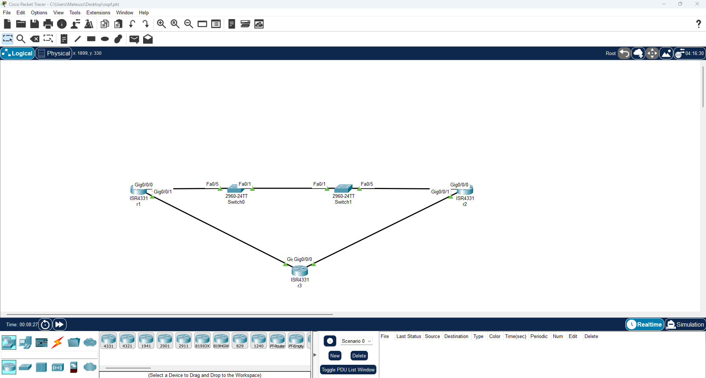

# OSPF-Dynamic-Routing-High-Availability-Topology-Redundant-WAN-# OSPF Dynamic Routing & High Availability Topology (Redundant WAN)

## 📌 Opis Projektu
Projekt przedstawia wdrożenie routingu dynamicznego **OSPF** w topologii trójkąta (trzy routery Cisco ISR4331), zapewniającej pełną redundancję łącza oraz automatyczną zbieżność (convergence) i przełączanie awaryjne (failover) w przypadku uszkodzenia ścieżki podstawowej.

---

## 🗺️ Topologia Sieci

---

## 🌐 Adresacja IP i Interfejsy

| Router | Interfejs | Adres IP | Status | Przypisanie / Sąsiedzi |
|:-------|:----------|:---------|:-------|:----------------------|
| **R1** | `GigabitEthernet0/0/0` | `10.53.0.1` | UP[cite: 3] | Połączenie / Ścieżka do R2 |
| **R1** | `GigabitEthernet0/0/1` | `10.53.1.1` | UP[cite: 3] | Połączenie do R3 |
| **R1** | `Loopback1` | `172.16.1.1` | UP[cite: 3] | Symulowana sieć LAN / Router ID |
| **R2** | `GigabitEthernet0/0/0` | `10.53.0.2` | UP[cite: 3] | Połączenie / Ścieżka do R1 |
| **R2** | `GigabitEthernet0/0/1` | `10.53.2.1` | UP[cite: 3] | Połączenie do R3 |
| **R2** | `Loopback1` | `192.168.1.1` | UP[cite: 3] | Symulowana sieć LAN / Router ID |
| **R3** | `GigabitEthernet0/0/0` | `10.53.2.3` | UP[cite: 3] | Połączenie do R2 |
| **R3** | `GigabitEthernet0/0/1` | `10.53.1.3` | UP[cite: 3] | Połączenie do R1 |

---

## 🛠️ Zastosowane Technologie
- **OSPFv2 (Process 56)** – protokół stanu łącza (Link-State) działający w obszarze bazowym (Area 0).
- **Redundancja i Failover** – architektura siatki częściowej pozwalająca na automatyczne przekierowanie ruchu okrężną drogą przez R3 w razie awarii bezpośredniego połączenia R1-R2.
- **Interfejsy Loopback** – stabilna identyfikacja routerów i testowa emulacja sieci lokalnych.

---

## 🧪 Testowanie Ścieżki Alternatywnej (Failover Test)
1. **Sprawdzenie statusu interfejsów:** `show ip interface brief`[cite: 3]
2. **Weryfikacja sąsiadów OSPF:** `show ip ospf neighbor`
3. **Symulacja awarii:** Wyłączenie interfejsu głównego (`shutdown`) powoduje natychmiastowe przeliczenie tablicy routingu przez algorytm SPF i przekierowanie ruchu przez router zapasowy.
